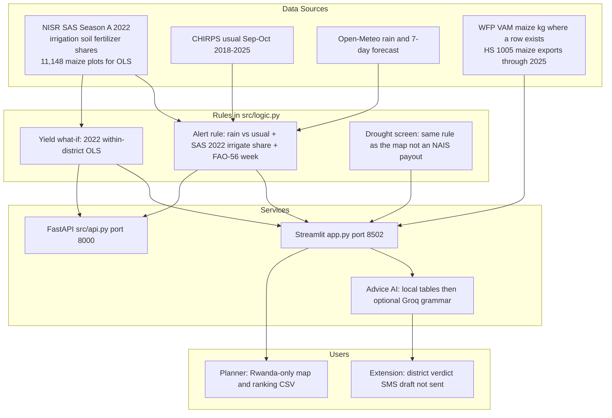

# CropWatch Rwanda
### National Agricultural Intelligence & Climate-Smart Decision Support Platform
**Republic of Rwanda · Aligned with Second National Strategy for Transformation (NST2 2024–2029) Priority Area 1: Agriculture Modernization**

[](https://streamlit.io)
[](https://fastapi.tiangolo.com)
[](https://python.org)
[](#bilingual-parity)
[](#institutional-provenance)

---

## 1. Executive Summary & Vision

**CropWatch Rwanda** is a Season A crop-water desk for Rwanda’s 30 districts. It is a student project for the **NISR 2026 Big Data Hackathon (Track 1: Agricultural productivity)**. It is **not** an official NISR or MINAGRI product.

It joins **NISR SAS Season A 2022** irrigation and soil shares, **Open-Meteo** rain since 1 September versus **CHIRPS 2018–2025** usual September–October, **FAO-56** weekly Pe−ETc, **WFP VAM** maize prices where a row exists, **Sentinel NDRE** as one district-year number, and formal **maize exports (HS 1005)** through 2025. Yield what-if uses **11,148** Season A 2022 maize plots (OLS). **28,042** is pooled 2022+2023+2025 maize only — not 2018–2026 geocoded plots.

It does **not** pay NAIS, send SMS, forecast the 2026 harvest, or invent a 60-day maize price.

English and Kinyarwanda labels are in sync.

**AI disclosure:** Groq model `openai/gpt-oss-20b` (optional, `GROQ_API_KEY` in `.streamlit/secrets.toml`) only **rephrases** Advice AI sentences. Alerts, yield gaps and SSIT figures come from the tables above. We used coding assistants to write software; we are responsible for the submitted work.

---

## 2. Strategic Policy & NST2 Alignment

Rwanda's **Second National Strategy for Transformation (NST2 2024–2029)** designates agricultural modernization, commercialization, and climate resilience as national economic priorities:

1. **Small-Scale Irrigation Technology (SSIT) Expansion:** Only 2.2% of sampled Season A agricultural plots nationwide are irrigated. CropWatch calculates real-time root-zone water deficits ($Pe - ET_c$) and models MINAGRI's 50% government equipment subsidy program to accelerate smallholder irrigation adoption up to 10 hectares.
2. **Hillside Soil Conservation & Radical Terracing:** With over 75% of Rwanda's cultivated land on slopes exceeding 16°, CropWatch identifies vulnerable hillside sectors requiring radical terracing, progressive terracing, and agroforestry hedgerows to halt topsoil loss.
3. **Agrometeorological Early Warning:** Combining historical CHIRPS precipitation baselines with live numerical weather forecasts enables agronomists and irrigation engineers to detect drought stress before crop wilting occurs.
4. **NAIS / Tekana:** The water screen is the same alert rule as the map. CropWatch does **not** enrol farmers or pay claims — that stays with the sector and licensed insurers.
5. **Last-mile draft:** Advice can be read aloud in the browser and packed into a **160-character SMS draft**. CropWatch does **not** send the text and is not wired to `*801#`.

---

## 3. Platform Architecture



---

## 4. Core Platform Desks

The platform organizes national agricultural intelligence into a streamlined, unified 7-desk operational pipeline:

| Module / Page | Operational Focus | Key Data Sources & Capabilities |
|---|---|---|
| **Executive Briefing** (`home`) | National Snapshot | National crisis snapshot, live pilot cards, 3-stage decision workflow, and NST2 strategic objectives. |
| **Alerts & Warnings** (`alerts`) | Early Warning & Water Deficit | Interactive 30-district Folium GIS map with layer toggles (Alerts, Rain Deficit, Irrigation, Soil Risk, NDRE), 7-day weather forecast, and automated irrigation triggers. |
| **National Analytics Hub** (`dashboard`) | Unified 30-District Intelligence | **Tab 1: 30-District Agricultural Matrix** (productivity benchmarks & SAS microdata).<br>**Tab 2: Multi-Season Climate Chronology** (CHIRPS anomalies, Sentinel-2 NDRE trendlines 2018–2026, WFP food commodity price tracking).<br>**Tab 3: Hillside Soil Conservation** (slope erosion risk ranking, radical vs progressive terracing targets, lime subsidy priorities). |
| **My district** (`district`) | Water, soil, yield what-if, SSIT, after harvest | FAO-56 week; 2022 OLS yield sliders (11,148 plots); SSIT 50% as a planning split; WFP maize or “no row”; PICS storage; maize exports through 2025. |
| **Advice AI** (`advise`) | Bilingual desk | Local tables first. Groq only rewrites grammar. Spoken audio. 160-character **SMS draft** (not sent). |
| **Open Data** (`data`) | Data Catalog & Governance | Transparent catalog of all cleaned district tables, seasonal crop calendars, price match indices, GeoJSON shapefiles, and direct CSV/JSON downloads. |
| **Institutional Charter** (`about`) | Governance, Team & Methodology | Institutional provenance (MINAGRI, NISR, RAB, Meteo Rwanda), verified hackathon engineering team credentials, and expandable scientific validation & machine learning benchmark documentation. |

---

## 5. Yield method (what the sliders actually run)

What-if sliders use **Season A 2022 within-district OLS** on **11,148 maize plots** (1st–99th yield window). They are **associations**, not a 2026 harvest forecast. A Random Forest was compared in `data/processed/app/model_benchmark.json`; it is **not** loaded at runtime (`joblib/` is empty).

Within-district 2022 effects (kg/ha): irrigation **+365**, inorganic **+524**, organic **+305**, severe erosion **−375**.

**Alerts:** rain vs usual = Open-Meteo vs CHIRPS Sep–Oct 2018–2025; irrigation share = SAS 2022; week water = FAO-56. Same rule as the map. Not an NAIS payout.

**Planner file:** Alerts page → *Download 30-district ranking (CSV)*.

---

## 6. Enterprise REST API (FastAPI)

FastAPI in `src/api.py` returns the **same district packages** as the Streamlit desk (no extra models):

```text
GET /                             # Service root
GET /api/health                   # Health + four pilot names
GET /api/status                   # National 30-district counts
GET /api/alerts                   # Full alert table
GET /api/pilots                   # Four pilots
GET /api/districts/{name}         # District pack + 7-day forecast
GET /api/models/yield/{district}  # 2022 OLS plot package (not a harvest forecast)
GET /api/models/drought/{district}# Same water screen as the map (payout always false)
GET /api/models/prices/{district} # Latest WFP maize row only (no 30/60/90-day forecast)
GET /api/chat/ask                 # Advice from local tables (optional Groq rewrite)
```

Run the API service:
```bash
uvicorn src.api:app --host 127.0.0.1 --port 8000 --reload
```
Interactive API docs are available at [http://localhost:8000/docs](http://localhost:8000/docs).

---

## 7. Quickstart & Installation

### Requirements
- Python 3.10, 3.11, or 3.12 (Python 3.12 recommended)
- Modern web browser (Chrome, Firefox, Safari, Edge)

### Step 1: Clone and Set Up Virtual Environment
```bash
# Clone repository
git clone https://github.com/rahe12/CropWatch-Rwanda.git
cd cropwatch-rwanda

# Create and activate virtual environment
python -m venv venv
# On Windows:
.\venv\Scripts\activate
# On Linux/macOS:
source venv/bin/activate
```

### Step 2: Install Dependencies
```bash
pip install --upgrade pip
pip install -r requirements.txt
```

### Step 3: Run the Streamlit Application
```bash
streamlit run app.py --server.port 8502
```
Access the application at [http://localhost:8502](http://localhost:8502).

### Streamlit Community Cloud (public URL for judges)

1. Push this repo to a **public** GitHub repository.
2. At [share.streamlit.io](https://share.streamlit.io) → New app → this repo, branch `main`, main file `app.py`.
3. Optional secrets: `GROQ_API_KEY` (grammar rewrite only). The desk runs without it.
4. Paste the public `https://….streamlit.app` URL in the NISR submission form.

Do **not** commit `.streamlit/secrets.toml`.

---

## 8. Comprehensive Documentation Suite

Detailed architectural, agronomic, and engineering documentation is provided in the `docs/` directory:

- [**System Architecture (`docs/ARCHITECTURE.md`)**](file:///docs/ARCHITECTURE.md): Architectural design, data flow diagrams, sub-10ms model execution specifications, and governance.
- [**Features & User Guide (`docs/FEATURES.md`)**](file:///docs/FEATURES.md): Operational guide detailing all 11 application desks, user personas, workflows, and interactive controls.
- [**Setup & Installation (`docs/SETUP.md`)**](file:///docs/SETUP.md): Step-by-step setup guide for Windows, Linux, and macOS, including background execution and troubleshooting.
- [**Enterprise REST API (`docs/API.md`)**](file:///docs/API.md): Complete OpenAPI reference, JSON request/response schemas, and client integration snippets.
- [**Data Sources & Limitations (`docs/DATA_SOURCES.md`)**](file:///docs/DATA_SOURCES.md): Rigorous catalog of NISR SAS microdata, CHIRPS, NASA POWER, Sentinel-2, WFP VAM, and analytical limitations.
- [**AI Chatbot & Agronomic Copilot (`docs/CHATBOT.md`)**](file:///docs/CHATBOT.md): Conversational architecture, 16 semantic intents, Web Speech API audio, and 160-char SMS generator.
- [**Quality Assurance & Testing (`docs/TESTING.md`)**](file:///docs/TESTING.md): Verification test suites, model cross-validation benchmarks, and bilingual parity checks.
- [**Official Hackathon Submission (`docs/HACKATHON_SUBMISSION.md`)**](file:///docs/HACKATHON_SUBMISSION.md): NISR 2026 Big Data Hackathon compliance, team eligibility, and judging criteria mapping.

---

## 9. NISR 2026 Big Data Hackathon Team & Eligibility

This platform was developed for the **NISR 2026 Big Data Hackathon** organized by the **National Institute of Statistics of Rwanda (NISR) Data Science Team**.

In strict accordance with official hackathon eligibility rules, the project was designed and engineered by a multidisciplinary team of two Year 4 undergraduate students from **Rwanda Polytechnic (RP Musanze College)**:

| Team Member | Academic Institution | Registration No | Academic Program | Primary Project Focus | Official Verification |
|---|---|---|---|---|---|
| **MURENZI Elvis** | Rwanda Polytechnic (Musanze College) | `26RP01872` | BTech in Information Technology (Year 4) | Full-Stack Architecture, FastAPI REST API, Local ML Inference & Voice TTS | [Student ID Card](file:///docs/team/student_id_murenzi_elvis_26RP01872.pdf) |
| **BAHIRE Elie** | Rwanda Polytechnic (Musanze College) | `26RP02259` | BTech in Irrigation and Drainage Technology (Year 4) | Agrometeorological Physics, FAO-56 Penman-Monteith Water Balance & Hillside Terracing | [Student ID Card](file:///docs/team/student_id_bahire_elie_26RP02259.pdf) |

Detailed submission deliverables, hackathon judging criteria alignment, and presentation slide mappings are documented in [**`docs/HACKATHON_SUBMISSION.md`**](file:///docs/HACKATHON_SUBMISSION.md).

---

## 10. Video Demonstration Deliverable

In compliance with NISR Hackathon Guidelines (Slides 12 & 13), the project repository includes a dedicated video demonstration folder:
- **Directory:** [`demo/`](file:///demo/README.md)
- **Format:** WebM (`.webm`) or GIF (`.gif`) screen recording strictly under 3 minutes.
- **Walkthrough Script:** Documented in [`demo/README.md`](file:///demo/README.md).

---

## 11. Institutional Provenance & Data Partners

- **NISR (National Institute of Statistics of Rwanda):** Seasonal Agricultural Survey (SAS) plot microdata, agricultural census baselines, and official 30-district administrative boundaries.
- **MINAGRI (Ministry of Agriculture and Animal Resources):** Strategic agricultural policy frameworks, SSIT guidelines, and crop intensification priorities.
- **RAB (Rwanda Agriculture and Animal Resources Development Board):** Extension advisory protocols, pest thresholds, and lime application standards.
- **Meteo Rwanda & CHIRPS (UCSB CHC):** Historical gridded precipitation baselines (1981–2025) and daily rainfall monitoring.
- **NASA POWER:** High-resolution surface solar radiation, air temperature, relative humidity, and wind telemetry.
- **Copernicus Sentinel-2:** Red-edge vegetation indices (NDRE) for crop vigor tracking.
- **WFP VAM & UN Comtrade:** Market retail commodity prices and formal cross-border grain flows.

---

*© 2026 Republic of Rwanda · CropWatch Rwanda · National Agricultural Intelligence & Climate-Smart Decision Support Platform*
