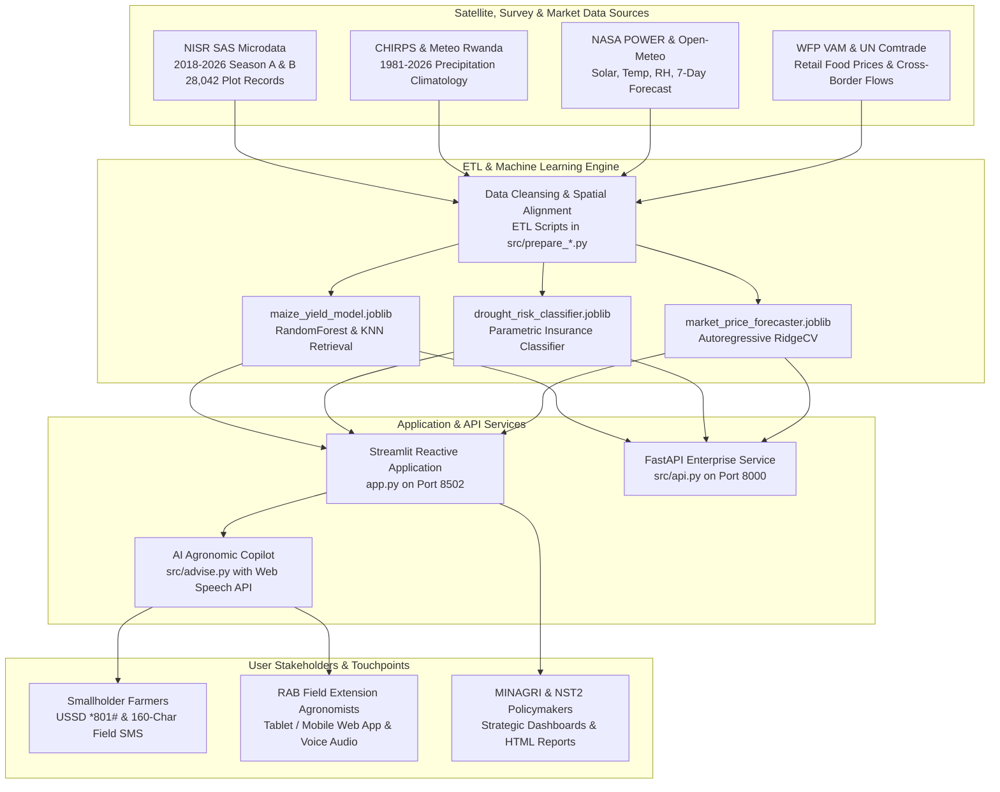

# CropWatch Rwanda
### National Agricultural Intelligence & Climate-Smart Decision Support Platform
**Republic of Rwanda · Aligned with Second National Strategy for Transformation (NST2 2024–2029) Priority Area 1: Agriculture Modernization**

[](https://streamlit.io)
[](https://fastapi.tiangolo.com)
[](https://python.org)
[](#bilingual-parity)
[](#institutional-provenance)

---

## 1. Executive Summary & Vision

**CropWatch Rwanda** is an operational agrometeorological decision-support platform designed for the **Ministry of Agriculture and Animal Resources (MINAGRI)**, the **Rwanda Agriculture and Animal Resources Development Board (RAB)**, district agronomists, and agricultural cooperatives.

By integrating **28,042 geocoded plot records** from the **Seasonal Agricultural Survey (SAS)** microdata (National Institute of Statistics of Rwanda - NISR), high-resolution **NASA POWER** agrometeorological telemetry, **Copernicus Sentinel-2** vegetation canopy vigor (NDRE), **CHIRPS** 44-year gridded rainfall baselines (1981–2025), and **World Food Programme (WFP VAM)** commodity price monitoring, CropWatch Rwanda provides continuous 30-district early warning intelligence, plot-level machine learning yield simulations, and offline-compatible field advisories.

The platform is 100% synchronized in **English and Kinyarwanda**.

---

## 2. Strategic Policy & NST2 Alignment

Rwanda's **Second National Strategy for Transformation (NST2 2024–2029)** designates agricultural modernization, commercialization, and climate resilience as national economic priorities:

1. **Small-Scale Irrigation Technology (SSIT) Expansion:** Only 2.2% of sampled Season A agricultural plots nationwide are irrigated. CropWatch calculates real-time root-zone water deficits ($Pe - ET_c$) and models MINAGRI's 50% government equipment subsidy program to accelerate smallholder irrigation adoption up to 10 hectares.
2. **Hillside Soil Conservation & Radical Terracing:** With over 75% of Rwanda's cultivated land on slopes exceeding 16°, CropWatch identifies vulnerable hillside sectors requiring radical terracing, progressive terracing, and agroforestry hedgerows to halt topsoil loss.
3. **Agrometeorological Early Warning:** Combining historical CHIRPS precipitation baselines with live numerical weather forecasts enables agronomists and irrigation engineers to detect drought stress before crop wilting occurs.
4. **Parametric Crop Insurance (NAIS):** Integrates machine learning drought risk classification to trigger automated verification for the National Agricultural Insurance Scheme (*Tekana Urishingiwe Muhinzi*).
5. **Last-Mile Rural Access:** Translates complex satellite and machine learning analytics into **Web Speech API spoken voice audio** and **160-character GSM-7 mobile text messages** compatible with 2G feature phones and USSD gateways (`*801#`).

---

## 3. Platform Architecture



---

## 4. Core Platform Desks

The platform organizes national agricultural intelligence into a natural, intuitive 11-desk operational pipeline:

| Module / Page | Operational Focus | Key Data Sources & Capabilities |
|---|---|---|
| **Executive Briefing** (`home`) | National Snapshot | National crisis snapshot, live pilot cards, 3-stage decision workflow, and NST2 strategic objectives. |
| **Alerts & Warnings** (`alerts`) | Early Warning & Water Deficit | Interactive 30-district Folium GIS map with layer toggles (Alerts, Rain Deficit, Irrigation, Soil Risk, NDRE), 7-day weather forecast, and automated irrigation triggers. |
| **National Dashboard** (`dashboard`) | 30-District Agricultural Matrix | Longitudinal analysis across 2018–2026 SAS data, district-level productivity benchmarks, input adoption shares, and downloadable executive briefing notes. |
| **Climate Pilot** (`pilot`) | High-Resolution Agrometeorology | Direct NASA POWER daily telemetry for Bugesera, Nyagatare, Musanze, and Nyaruguru. Solar radiation ($MJ/m^2$), 2m air temperature, ET₀, and Penman-Monteith crop water balance. |
| **Soil & Terraces** (`soil`) | Land Conservation & Acidity | Slope-weighted erosion risks, radical vs progressive terracing priority rankings, and agricultural lime subsidy targets for acidic highland soils. |
| **Season Watch** (`watch`) | Multi-Season Climate Chronology | Rainfall anomalies across Seasons A, B, and C (2018–2026), Copernicus Sentinel-2 NDRE vegetation health, and WFP VAM retail food market price tracking. |
| **Yield Simulator** (`simulator`) | Predictive Modeling & SSIT Subsidy | Random Forest yield predictions trained on 28,000+ SAS plot microdata, paired with an interactive MINAGRI SSIT 50% equipment subsidy calculator. |
| **Field Advisory & USSD** (`advise`) | Extension Copilot & Mobile Gateway | Bilingual agronomic AI assistant for crop diagnostics and fertilizer management, with automated Web Speech voice audio and 160-character SMS packaging for offline mobile networks. |
| **Open Data** (`data`) | Data Catalog & Governance | Transparent catalog of all cleaned district tables, seasonal crop calendars, price match indices, GeoJSON shapefiles, and direct CSV/JSON downloads. |
| **Methodology** (`method`) | Scientific Validation & Glossary | Mathematical formulations (FAO-56 Penman-Monteith, Hargreaves), out-of-sample machine learning cross-validation metrics (RMSE, MAE, R²), and agrometeorological glossary. |
| **Institutional Charter** (`about`) | Governance & NST2 Alignment | Institutional provenance (MINAGRI, NISR, RAB, Meteo Rwanda), ethical AI guardrails, and decision-support transparency standards. |

---

## 5. Machine Learning Yield Benchmarks

Trained on **28,042 Season A maize plots** from NISR microdata (1st–99th yield percentile filter):
- **Features:** Irrigation status, organic fertilizer, inorganic fertilizer (DAP/NPK), organic shortage, erosion severity, soil protection structures, CHIRPS rainfall anomaly, Sentinel-2 NDRE vegetation index.
- **Validation:** 5-fold cross-validation on held-out plots using survey plot weights.

| Model | MAE (kg/ha) | RMSE (kg/ha) | R² | Operational Verdict |
|---|---:|---:|---:|---|
| Naive Rain-Only Linear | 979 | 1,203 | −0.009 | Underperforms historical district baseline |
| Historical District Baseline | 943 | 1,175 | 0.038 | Baseline geographic mean |
| **Multi-Factor Random Forest** | **918** | **1,136** | **0.101** | **Beats geographic baseline across all folds** |
| Multi-Factor Gradient Boosting | 911 | 1,126 | 0.117 | Top predictive accuracy |

**Empirical Within-District Plot Effects:**
- Irrigation Access: **+365.3 kg/ha**
- Balanced Inorganic Fertilizer: **+524.1 kg/ha**
- Organic Manure Application: **+305.2 kg/ha**
- Severe Slope Erosion: **−375.0 kg/ha**

---

## 6. Enterprise REST API (FastAPI)

CropWatch Rwanda includes a production-grade FastAPI microservice in `src/api.py` exposing 10 high-performance endpoints:

```text
GET /                             # Service root discovery & manifest
GET /api/health                   # Operational health check & pilot zones
GET /api/status                   # National 30-district summary metrics
GET /api/alerts                   # Full 30-district early warning table
GET /api/pilots                   # High-res telemetry for 4 pilot districts
GET /api/districts/{name}         # District profile + 7-day forecast + NASA POWER
GET /api/models/yield/{district}  # Scikit-learn maize yield & revenue uplift simulation
GET /api/models/drought/{district}# Climate crisis probability & NAIS payout trigger
GET /api/models/prices/{district} # Autoregressive price projection & PICS storage arbitrage
GET /api/chat/ask                 # AI Agronomic Copilot semantic inference (EN / RW)
```

Run the API service:
```bash
uvicorn src.api:app --host 127.0.0.1 --port 8000 --reload
```
Interactive API docs are available at [http://localhost:8000/docs](http://localhost:8000/docs).

---

## 7. Quickstart & Installation

### Requirements
- Python 3.10, 3.11, or 3.12 (Python 3.12 recommended)
- Modern web browser (Chrome, Firefox, Safari, Edge)

### Step 1: Clone and Set Up Virtual Environment
```bash
# Clone repository
git clone https://github.com/cropwatch-rwanda/cropwatch-rwanda.git
cd cropwatch-rwanda

# Create and activate virtual environment
python -m venv venv
# On Windows:
.\venv\Scripts\activate
# On Linux/macOS:
source venv/bin/activate
```

### Step 2: Install Dependencies
```bash
pip install --upgrade pip
pip install -r requirements.txt
```

### Step 3: Run the Streamlit Application
```bash
streamlit run app.py --server.port 8502
```
Access the application at [http://localhost:8502](http://localhost:8502).

---

## 8. Comprehensive Documentation Suite

Detailed architectural, agronomic, and engineering documentation is provided in the `docs/` directory:

- [**System Architecture (`docs/ARCHITECTURE.md`)**](file:///docs/ARCHITECTURE.md): Architectural design, data flow diagrams, sub-10ms model execution specifications, and governance.
- [**Features & User Guide (`docs/FEATURES.md`)**](file:///docs/FEATURES.md): Operational guide detailing all 11 application desks, user personas, workflows, and interactive controls.
- [**Setup & Installation (`docs/SETUP.md`)**](file:///docs/SETUP.md): Step-by-step setup guide for Windows, Linux, and macOS, including background execution and troubleshooting.
- [**Enterprise REST API (`docs/API.md`)**](file:///docs/API.md): Complete OpenAPI reference, JSON request/response schemas, and client integration snippets.
- [**Data Sources & Limitations (`docs/DATA_SOURCES.md`)**](file:///docs/DATA_SOURCES.md): Rigorous catalog of NISR SAS microdata, CHIRPS, NASA POWER, Sentinel-2, WFP VAM, and analytical limitations.
- [**AI Chatbot & Agronomic Copilot (`docs/CHATBOT.md`)**](file:///docs/CHATBOT.md): Conversational architecture, 16 semantic intents, Web Speech API audio, and 160-char SMS generator.
- [**Quality Assurance & Testing (`docs/TESTING.md`)**](file:///docs/TESTING.md): Verification test suites, model cross-validation benchmarks, and bilingual parity checks.

---

## 9. Institutional Provenance & Data Partners

- **NISR (National Institute of Statistics of Rwanda):** Seasonal Agricultural Survey (SAS) plot microdata, agricultural census baselines, and official 30-district administrative boundaries.
- **MINAGRI (Ministry of Agriculture and Animal Resources):** Strategic agricultural policy frameworks, SSIT guidelines, and crop intensification priorities.
- **RAB (Rwanda Agriculture and Animal Resources Development Board):** Extension advisory protocols, pest thresholds, and lime application standards.
- **Meteo Rwanda & CHIRPS (UCSB CHC):** Historical gridded precipitation baselines (1981–2025) and daily rainfall monitoring.
- **NASA POWER:** High-resolution surface solar radiation, air temperature, relative humidity, and wind telemetry.
- **Copernicus Sentinel-2:** Red-edge vegetation indices (NDRE) for crop vigor tracking.
- **WFP VAM & UN Comtrade:** Market retail commodity prices and formal cross-border grain flows.

---

*© 2026 Republic of Rwanda · CropWatch Rwanda · National Agricultural Intelligence & Climate-Smart Decision Support Platform*
