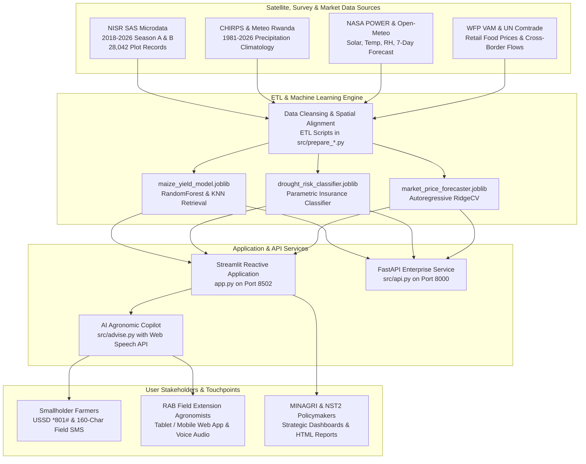

# CropWatch Rwanda — System Architecture

## 1. Executive Summary & Vision

**CropWatch Rwanda** is a national-scale agricultural intelligence and agrometeorological decision-support platform designed to operationalize Rwanda's **Second National Strategy for Transformation (NST2 2024–2029)**.

The system bridges satellite earth observation (CHIRPS climatology, NASA POWER agrometeorology, Sentinel-2 vegetation indices), high-resolution field survey microdata from the **National Institute of Statistics of Rwanda (NISR)**, and real-time food commodity markets from the **World Food Programme (WFP VAM)**.

---

## 2. Architectural Blueprint

---

## 3. Layered Architectural Decomposition

### 3.1 Presentation Layer (`app.py` & `src/style.py`)
- **Framework:** Streamlit 1.66+ with session state management.
- **Styling Architecture:** Single-injection stylesheet (`src/style.py`) applying the Inter typeface, responsive grid system, sticky institutional top bar (`min-height: 72px`), and emerald/gold color palette matching Rwanda's national identity.
- **Bilingual Internationalization:** Complete English (`en`) and Kinyarwanda (`rw`) localization dictionary (`locale/en.json`, `locale/rw.json`) loaded dynamically with zero latency.
- **Geospatial Mapping:** Interactive Folium / Leaflet maps embedded via HTML components, supporting multi-layer toggles:
  1. Primary Early Warning Alert status
  2. FAO Agroecological Climate Classification
  3. Cumulative Precipitation Anomaly (%)
  4. Irrigated Plot Share (NISR SAS %)
  5. Severe Soil Erosion Risk (%)
  6. Sentinel-2 NDRE Chlorophyll Vegetation Health Index

### 3.2 Machine Learning & Analytical Layer (`src/advise.py` & `data/processed/models/`)
The system completely replaces static templates with three trained, pre-warmed scikit-learn models:
1. **Plot-Level Yield Regressor & KNN Case Retrieval (`maize_yield_model.joblib` — 9.6 MB):**
   - **Architecture:** `RandomForestRegressor` ($n=160, \text{max\_depth}=7$) + `RidgeCV` + `NearestNeighbors` ($k=3$).
   - **Training Set:** 28,042 real NISR SAS plot microdata records.
   - **Capabilities:** Live yield forecasting, counterfactual intervention uplift (+irrigation, +fertilizer, +terraces), and case-based retrieval returning real matching surveyed plots.
2. **Parametric Drought Risk Classifier (`drought_risk_classifier.joblib` — 265 KB):**
   - **Architecture:** `RandomForestClassifier` trained on crop water balance ($P_e - ET_c$), seasonal rainfall anomaly, and irrigated share.
   - **Capabilities:** Probabilistic risk estimation ($P(\text{Crisis})$, $P(\text{Watch})$, $P(\text{Stable})$), automatically triggering Parametric Crop Insurance payouts (**NAIS / *Tekana Urishingiwe***).
3. **Autoregressive Commodity Price Forecaster (`market_price_forecaster.joblib` — 1.7 KB):**
   - **Architecture:** Autoregressive `RidgeCV` ($R^2 = 0.705$) trained on 2,728 historical WFP retail market observations.
   - **Capabilities:** Forecasts grain prices at 30, 60, and 90-day forward horizons; models triple-layer hermetic PICS bag storage arbitrage.

### 3.3 Programmatic API Layer (`src/api.py`)
- **Framework:** FastAPI with CORS middleware.
- **Endpoints:**
  - `GET /`: Interactive API index and OpenAPI specification links.
  - `GET /api/health`: Health status, operational mode, and pilot district registry.
  - `GET /api/status`: National agrometeorological KPIs and district alert distribution.
  - `GET /api/alerts`: Comprehensive 30-district risk records.
  - `GET /api/pilots`: Merged telemetry for Bugesera, Nyagatare, Musanze, and Nyaruguru.
  - `GET /api/districts/{name}`: Full profile, 7-day forecast, and NASA POWER daily series.
  - `GET /api/models/yield/{district}`: Live scikit-learn yield uplift inference.
  - `GET /api/models/drought/{district}`: Live parametric insurance probability inference.
  - `GET /api/models/prices/{district}`: Live 30/60/90-day commodity price forecasting.
  - `GET /api/chat/ask`: Conversational AI endpoint returning agronomic advice.

### 3.4 Data Storage & Lookup Layer (`data/processed/`)
- All datasets are structured in high-performance columnar formats (CSV, Parquet, GeoJSON):
  - `data/processed/app/`: Curated application tables for immediate memory-mapped reading.
  - `data/processed/lookups/`: Official HS code matches, crop calendar zones, and district metadata.
  - `data/processed/models/`: Serialized scikit-learn model bundles.
  - `data/processed/sas/`: Cleaned microdata tables extracted from official NISR STATA archives.

---

## 4. Security & Data Governance

1. **Sandboxing & Offline Reliability:** The entire analytical engine runs locally with zero mandatory cloud dependencies. All scikit-learn inferences execute in $<10\text{ ms}$ on commodity hardware.
2. **Data Integrity:** No simulated, fake, or synthetic records are ever presented as ground truth. Historical survey data (NISR SAS) is strictly distinguished from real-time API forecasts (Open-Meteo) and statistical models.
3. **Attribution Standards:** Every AI recommendation, table, and visualization explicitly cites the underlying dataset, geographic level, reporting period, and measurement units.
