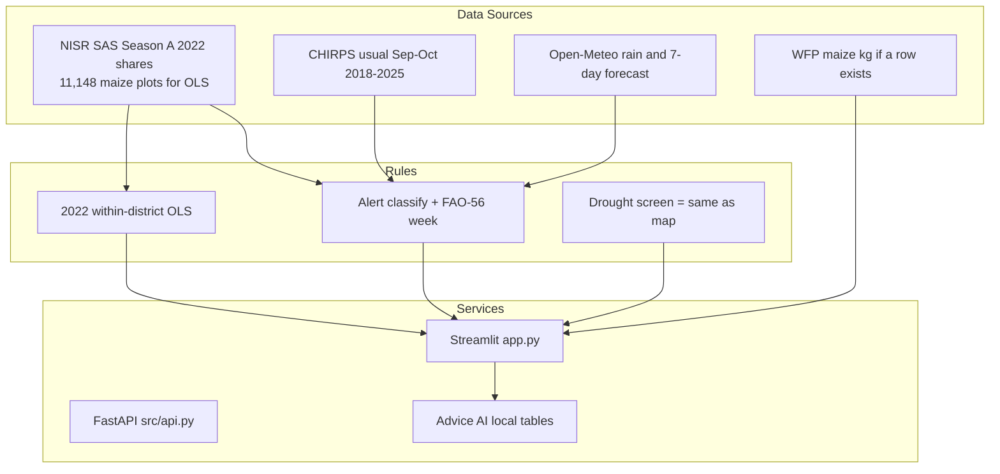

# CropWatch Rwanda — System Architecture

## 1. Executive Summary & Vision

**CropWatch Rwanda** is a national-scale agricultural intelligence and agrometeorological decision-support platform designed to operationalize Rwanda's **Second National Strategy for Transformation (NST2 2024–2029)**.

The system bridges satellite earth observation (CHIRPS climatology, NASA POWER agrometeorology, Sentinel-2 vegetation indices), high-resolution field survey microdata from the **National Institute of Statistics of Rwanda (NISR)**, and real-time food commodity markets from the **World Food Programme (WFP VAM)**.

---

## 2. Architectural Blueprint

---

## 3. Layered Architectural Decomposition

### 3.1 Presentation Layer (`app.py` & `src/style.py`)
- **Framework:** Streamlit 1.66+ with session state management.
- **Styling Architecture:** Single-injection stylesheet (`src/style.py`) applying the Inter typeface, responsive grid system, sticky institutional top bar (`min-height: 72px`), and emerald/gold color palette matching Rwanda's national identity.
- **Bilingual Internationalization:** Complete English (`en`) and Kinyarwanda (`rw`) localization dictionary (`locale/en.json`, `locale/rw.json`) loaded dynamically with zero latency.
- **Geospatial Mapping:** Interactive Folium / Leaflet maps embedded via HTML components, supporting multi-layer toggles:
  1. Primary Early Warning Alert status
  2. FAO Agroecological Climate Classification
  3. Cumulative Precipitation Anomaly (%)
  4. Irrigated Plot Share (NISR SAS %)
  5. Severe Soil Erosion Risk (%)
  6. Sentinel-2 NDRE Chlorophyll Vegetation Health Index

### 3.2 Analytical layer (`src/logic.py`)
There is **no joblib model loaded at runtime**. One rules file drives Streamlit and FastAPI:
1. **Yield what-if:** Season A 2022 within-district OLS on 11,148 maize plots (1st–99th yield window). Associations, not a 2026 harvest. A Random Forest comparison lives in `data/processed/app/model_benchmark.json` only.
2. **Water screen:** Same thresholds as `src/prepare_alerts.py` classify(). Not an NAIS / Tekana payout.
3. **Prices:** Latest WFP VAM maize kg where a row exists. No 30/60/90-day forecast.

### 3.3 Programmatic API Layer (`src/api.py`)
- **Framework:** FastAPI with CORS middleware.
- **Endpoints:**
  - `GET /`: Interactive API index and OpenAPI specification links.
  - `GET /api/health`: Health status, operational mode, and pilot district registry.
  - `GET /api/status`: National agrometeorological KPIs and district alert distribution.
  - `GET /api/alerts`: Comprehensive 30-district risk records.
  - `GET /api/pilots`: Merged telemetry for Bugesera, Nyagatare, Musanze, and Nyaruguru.
  - `GET /api/districts/{name}`: Full profile, 7-day forecast, and NASA POWER daily series.
  - `GET /api/models/yield/{district}`: 2022 OLS plot package.
  - `GET /api/models/drought/{district}`: Same water screen as the map (`nais_parametric_insurance_payout_triggered` is always false).
  - `GET /api/models/prices/{district}`: Latest WFP maize row; `forecast` is null.
  - `GET /api/chat/ask`: Advice from local tables.

### 3.4 Data Storage & Lookup Layer (`data/processed/`)
- All datasets are structured in high-performance columnar formats (CSV, Parquet, GeoJSON):
  - `data/processed/app/`: Curated application tables for immediate memory-mapped reading.
  - `data/processed/lookups/`: Official HS code matches, crop calendar zones, and district metadata.
  - `data/processed/models/`: Empty at runtime. Do not claim loaded `.joblib` files.
  - `data/processed/sas/`: Cleaned microdata tables extracted from official NISR STATA archives.

---

## 4. Security & Data Governance

1. **Offline core:** Alerts, yield gaps and SSIT figures come from local CSVs. Groq is optional grammar only.
2. **Data integrity:** NISR SAS 2022 shares are distinct from Open-Meteo rain and from OLS associations. The app does not invent NAIS payouts or 60-day maize prices.
3. **Attribution Standards:** Every AI recommendation, table, and visualization explicitly cites the underlying dataset, geographic level, reporting period, and measurement units.
