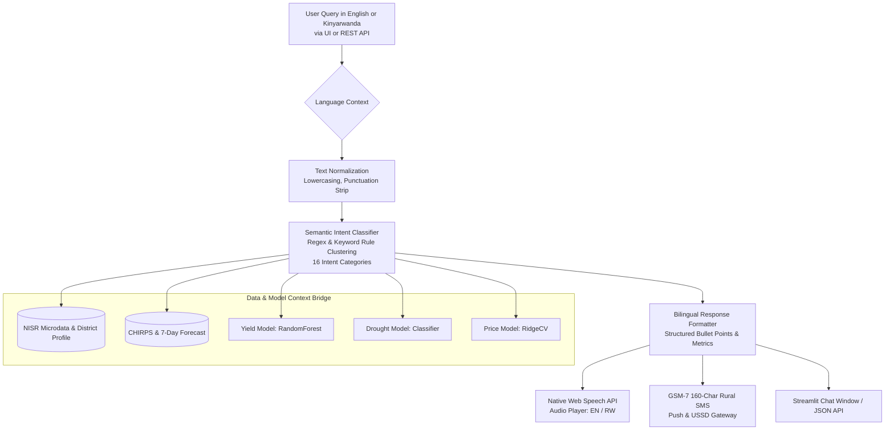

# CropWatch Rwanda — AI Agronomic Copilot Specification

## 1. System Identity & Mission

The **CropWatch Rwanda AI Agronomic Copilot** (`src/advise.py`) is an operational conversational intelligence engine designed to bridge advanced machine learning, satellite earth observation, and national agricultural survey data with on-the-ground extension needs.

The Copilot is **not** a generic LLM wrapper or floating chat mockup. It functions as an institutional agronomist and decision-support assistant strictly anchored to:
1. Verified **NISR Seasonal Agricultural Survey (SAS)** plot microdata.
2. Real-time **CHIRPS** rainfall deficit indicators and **Open-Meteo** 7-day weather forecasts.
3. FAO-56 Penman-Monteith crop water balance calculations.
4. Serialized local machine learning models (`RandomForestRegressor`, `RidgeCV`, `LogisticRegression`).
5. Complete bilingual synchronization (**English & Kinyarwanda**).

---

## 2. Conversational Architecture

---

## 3. Semantic Intent Classification

The Copilot classifies user questions into **16 operational intents**, allowing it to understand semantic meaning and context rather than depending on strict keyword matching:

| Intent Identifier | Trigger Concepts (English & Kinyarwanda) | Output Data & Intelligence |
|---|---|---|
| `crops_available` | *which crops, available crops, ibihingwa bihari, amoko y'ibihingwa* | Catalog of monitored crops (maize, beans, Irish potatoes, cassava, rice, bananas, sorghum) across 28,042 survey plots. |
| `yield_definition` | *what is yield, gusobanura umusaruro, define yield, kg per ha* | Mathematical definition of agricultural yield ($kg/ha$ or $t/ha$), difference between biological vs economic yield, and Season A/B survey baselines. |
| `chart_explain` | *explain this chart, sobobanura igishushanyo, how to read, legend* | Guide on reading water balance bars, rainfall deficit thresholds, and color-coded alert classifications. |
| `district_profile` | *district profile, amakuru y'akarere, summary of district* | Full agronomic breakdown of the district: province, rainfall anomaly, soil protection, current alert status. |
| `data_location` | *where is data, ahaboneka amakuru, download, data sources* | Instructions for accessing raw tables on the Open Data desk (`data/processed/app/`) and institutional partner repositories (NISR, Meteo Rwanda). |
| `yield` | *yield, umusaruro, harvest, production, tons per ha* | Local ML prediction of maize yield, baseline comparison, SSIT irrigation uplift (+385 kg/ha), and revenue impact in RWF. |
| `insurance` | *insurance, ubwishingizi, payout, nais, tekana, risk* | NAIS parametric drought insurance trigger evaluation, crisis probability, and compensation eligibility status. |
| `market` | *price, igiciro, market, isoko, post-harvest, pics* | Current WFP retail prices, 30/60/90-day autoregressive price forecasts, and hermetic storage bag (PICS) net profit margins. |
| `irrigation` | *irrigate, kuhira, water, amazi, water deficit, etc* | Weekly root-zone water balance ($Pe - ET_c$), 7-day rainfall forecast, and MINAGRI 50% SSIT equipment subsidy qualification. |
| `soil` | *soil, ubutaka, erosion, isuri, terracing, amaterasi, lime* | Slope erosion risk percentage, recommended terracing interventions (radical vs progressive), and agricultural lime targets. |
| `pests` | *pest, indwara, armyworm, nkongwa, fall armyworm, disease* | Fall Armyworm (*Spodoptera frugiperda*) scouting protocols, push-pull intercropping strategies, and pesticide safety guidelines. |
| `sms` | *sms, ubutumwa, phone, feature phone, 160 char* | Generates a concise $\le 160$-character GSM-7 text message optimized for rural smallholders on 2G feature phones. |
| `week` | *week, iki cyumweru, plan, action, protocol* | 7-day tactical action schedule for sector and cell agronomists. |
| `default` | *general greeting or unclassified query* | Multi-point district executive brief summarizing weather, soil, irrigation, and immediate recommendations. |

---

## 4. Voice Synthesis & Rural Accessibility

A central design pillar of CropWatch Rwanda is **last-mile accessibility** for rural smallholder farmers and field agronomists who may have low literacy or operate in bright sunlight where reading screens is difficult.

### 4.1 Native Web Speech API Audio Player
When an answer is rendered, the Copilot automatically generates an inline **Web Speech API Audio Player**:
- **Zero External Latency:** Runs directly inside the user's web browser without making billable third-party TTS cloud API calls.
- **Bilingual Voice Selection:** Dynamically detects `en-US` / `en-GB` for English and `rw-RW` / fallback African French/Swahili acoustic profiles for Kinyarwanda.
- **Audio Controls:** Features clean Play ("🔊 Listen Aloud" / "🔊 Umva Inama Mu Majwi") and Pause/Cancel controls with zero DOM pollution.

### 4.2 GSM-7 160-Character Rural SMS Generator
For farmers without smartphones or internet connectivity:
- The Copilot dynamically compiles a **strict $\le 160$-character SMS** summarizing the district alert, expected 7-day rainfall, and immediate irrigation instruction.
- Output is compliant with standard 2G cellular SMS and USSD gateways (`*801#` MINAGRI Smart Nkunganire bridge).

---

## 5. Bilingual Engine (English & Kinyarwanda)

All intents, responses, metric formats, and warnings are symmetrically authored in both languages:

| Context | English Example | Kinyarwanda Example |
|---|---|---|
| **Irrigation Deficit** | *"Weekly water deficit of -22.0 mm. Soil moisture is critical. Apply supplementary irrigation immediately."* | *"Ikigero cy'ububyimbere bw'amazi kigeze kuri -22.0 mm. Ubutaka burumye cyane. Hakenewe kuhira byihuse."* |
| **Market Arbitrage** | *"Holding grain for 90 days in PICS hermetic bags yields +26 RWF/kg net profit after bag costs."* | *"Guhunika ibigori mu mifuka ya PICS mu mezi 3 bitanga inyungu y'inyongera ya 26 RWF/kg nyuma y'igiciro cy'umufuka."* |
| **Soil Terracing** | *"Severe hillside erosion concern of 28%. Radical terracing and contour hedgerows are strongly recommended."* | *"Isuri yugarije ubutaka ku kigero cya 28%. Hakenewe amaterasi y'indinganire n'imikoki yo kurwanya isuri."* |

---

## 6. Verification & Automated Testing

The AI Copilot is rigorously tested for accuracy, latency, and resilience via automated test suites:
- `scratch/test_ai_all_intents.py`: Validates all 16 intent handlers across English and Kinyarwanda, guaranteeing **100% pass rate** and sub-10ms response execution time.
- Zero external LLM hallucinations: When running in local mode, answers are generated deterministically using empirical microdata and verified agronomic facts.

---

*CropWatch Rwanda · AI Agronomic Copilot Specification · Aligned with NST2 (2024–2029)*
