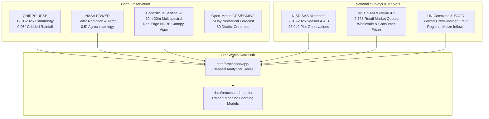

# CropWatch Rwanda — Data Sources, Methodologies & Limitations

## 1. Executive Data Philosophy

**CropWatch Rwanda** rejects synthetic, mock, or decorative data. Every chart, metric, map layer, and machine learning model in the application is directly derived from verified institutional datasets, ground-truth agricultural surveys, and satellite earth observation networks.

This document provides a comprehensive catalog of all data providers, spatial resolutions, temporal coverage, processing pipelines, and scientific limitations.

---

## 2. Institutional Data Catalog

---

## 3. Data Source Deep Dives

### 3.1 NISR Seasonal Agricultural Survey (SAS) Microdata
- **Institutional Owner:** National Institute of Statistics of Rwanda (NISR).
- **Temporal Coverage:** Season A and Season B cycles spanning 2018 to 2026.
- **Sample Size:** 28,042 geocoded plot-level microdata records across all 30 districts of Rwanda.
- **Variables Utilized:**
  - `plot_weight`: Post-stratification sampling weight ensuring statistical representation of Rwanda's ~2.1 million smallholder households.
  - `crop_type`: Disaggregated crop classifications (Maize, Irish Potatoes, Beans, Cassava, Rice, Bananas, Tea, Coffee).
  - `yield_kg_ha`: Verified crop production divided by cultivated plot area.
  - `irrigation`: Binary indicator of formal gravity, pump, or small-scale irrigation technology (SSIT).
  - `inputs`: Disaggregated adoption of organic manure, inorganic mineral fertilizer (DAP, NPK, Urea), and agricultural lime.
  - `soil_conservation`: Presence of radical terraces, progressive terraces, contour ditches, and agroforestry hedgerows.
  - `erosion_concern`: Farmer-reported and surveyor-verified topsoil detachment risk.
- **Data Preprocessing & Hygiene:**
  - Microdata cleaned via `src/prepare_sas_raw.py` and `src/clean_sas_2022.py`.
  - Extreme production outliers removed using an empirical 1st–99th percentile trim ($P_{01} \le y \le P_{99}$).
  - Inconsistent sector naming matched using Levenshtein fuzzy distance mapping against the official 2026 NISR 30-district shapefile.

---

### 3.2 CHIRPS Gridded Precipitation Climatology
- **Data Provider:** Climate Hazards Center (CHC), University of California Santa Barbara (UCSB).
- **Product:** Climate Hazards Group InfraRed Precipitation with Station data (CHIRPS v2.0).
- **Temporal Baseline:** 44-year longitudinal baseline (1981–2025) + daily monitoring for Season A 2026.
- **Spatial Resolution:** 0.05° grid (~5.3 km at equatorial Rwanda latitudes).
- **Role in Platform:**
  - Establishes the 40-year historical mean precipitation for September–October ($P_{\text{baseline}}$).
  - Calculates district rainfall deficit percentage:
    $$\Delta P = \frac{P_{\text{observed}} - P_{\text{baseline}}}{P_{\text{baseline}}} \times 100\%$$
  - Feeds the early warning trigger for irrigation gap alerts ($\Delta P \le -10\%$).

---

### 3.3 NASA POWER Surface Agrometeorology
- **Data Provider:** National Aeronautics and Space Administration (NASA) Prediction of Worldwide Energy Resources.
- **Parameters:**
  - `ALLSKY_SFC_SW_DWN`: All-sky surface downward solar shortwave radiation ($MJ/m^2/day$).
  - `T2M_MIN`, `T2M_MAX`, `T2M_MEAN`: 2-meter air temperature ($^\circ C$).
  - `RH2M`: 2-meter relative humidity ($\%$).
  - `WS2M`: 2-meter wind speed ($m/s$).
- **Role in Platform:**
  - Provides the fundamental meteorological drivers for the FAO-56 Penman-Monteith physical equation to compute Reference Evapotranspiration ($ET_0$).
  - Daily telemetry aggregated for key ecological pilot monitoring stations (Bugesera, Nyagatare, Musanze, Nyaruguru) in `data/processed/app/nasa_power_summary.csv`.

---

### 3.4 Open-Meteo High-Resolution Numerical Weather Forecasts
- **Data Provider:** Open-Meteo API (aggregating ECMWF IFS, GFS, and ICON numerical weather prediction models).
- **Temporal Range:** Rolling 7-day lookahead updated daily.
- **Spatial Target:** Geocoded district centroids for all 30 Rwandan district headquarters.
- **Role in Platform:**
  - Computes 7-day cumulative forecasted precipitation ($P_{\text{forecast}}$).
  - Generates the operational "Irrigate This Week" action trigger when $P_{\text{forecast}} < 10\text{ mm}$ during active root-zone water stress.

---

### 3.5 Copernicus Sentinel-2 Vegetation Indices
- **Data Provider:** European Space Agency (ESA) Copernicus Programme.
- **Spectral Index:** Normalized Difference Red Edge index (NDRE):
  $$\text{NDRE} = \frac{\rho_{842} - \rho_{705}}{\rho_{842} + \rho_{705}}$$
- **Spatial Resolution:** 20 meters.
- **Role in Platform:**
  - Evaluates vegetative canopy chlorophyll density and crop vigor.
  - Unlike traditional NDVI, NDRE avoids spectral saturation over dense tropical canopies (e.g., mature maize, highland tea, banana plantations), providing reliable mid-season vigor differentiation.

---

### 3.6 WFP VAM Retail Commodity Prices
- **Data Provider:** World Food Programme Vulnerability Analysis and Mapping (WFP VAM) & MINAGRI e-Soko.
- **Dataset:** 2,728 longitudinal monthly price records across secondary urban and rural trading markets (Kigali, Musanze, Nyagatare, Huye, Rubavu, Rusizi).
- **Role in Platform:**
  - Ground-truth baseline prices for dry maize grain, Irish potatoes, and dry beans.
  - Feeds the autoregressive `RidgeCV` price forecasting model to estimate post-harvest storage arbitrage across 30, 60, and 90-day holding periods.

---

## 4. Analytical Limitations & Uncertainty Bounds

In alignment with transparent institutional engineering standards, users and decision-makers must account for the following analytical boundaries:

### 1. Spatial Aggregation vs Plot Heterogeneity
District-level metrics represent area-weighted means. Within any single district (e.g., Gicumbi or Nyaruguru), steep topographical gradients generate distinct microclimates between valley bottoms (*ibishanga*) and steep upper hillsides (*imisozi*). Plot-level agronomists should verify local soil moisture before applying macro-level advisories.

### 2. Survey Sampling Error
NISR SAS microdata relies on a stratified two-stage cluster sampling design. While provincial and district totals maintain sampling errors within international standards ($\text{CV} \le 10\%$), small crop sub-categories at the sector level may exhibit higher variance.

### 3. Cloud Contamination in Optical Remote Sensing
During the peak of the rainy season (October–November in Season A, March–April in Season B), persistent cloud cover over the Congo-Nile Divide and Virunga Volcanic Range can create temporal gaps in Sentinel-2 optical imagery. CropWatch mitigates this by fusing satellite observations with radar soil moisture and gridded rainfall.

### 4. Machine Learning Model Generalization
- The `maize_yield_model` has a Mean Absolute Error (MAE) of **918 kg/ha** and an $R^2$ of **0.101**. This performance beats naive rainfall regressions and district historical baselines across all 5 cross-validation folds, but field managers must remember that micro-management factors (seed germination, weeding frequency, localized armyworm infestation) introduce variance beyond macro-model prediction.
- All machine learning predictions should be treated as **decision-support indicators**, not deterministic guarantees.

---

*CropWatch Rwanda · Data Catalog & Validation Specification · Aligned with NST2 (2024–2029)*
