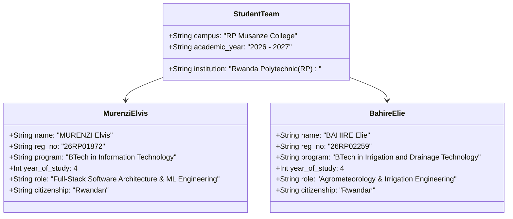

# NISR 2026 Big Data Hackathon — Official Submission & Team Eligibility

## 1. Project Information & Metadata

- **Project Title:** **CropWatch Rwanda** — National Agricultural Intelligence & Climate-Smart Decision Support Platform
- **Competition:** **NISR 2026 Big Data Hackathon**
- **Organizing Institution:** **National Institute of Statistics of Rwanda (NISR)** — Data Science Team
- **Submission Deadline:** **30 October 2026**
- **Public GitHub Repository:** [https://github.com/rahe12/CropWatch-Rwanda](https://github.com/rahe12/CropWatch-Rwanda)
- **Deployed Web Application:** Paste the Streamlit Community Cloud URL here (`https://….streamlit.app`). `localhost:8502` is for local work only.
- **Enterprise REST API:** [http://localhost:8000/docs](http://localhost:8000/docs)
- **Video Demonstration:** [`demo/`](file:///demo/README.md) (Screen recording $\le 3$ minutes)

---

## 2. Engineering Team & Verified Student Eligibility

In strict accordance with **NISR Big Data Hackathon Rule 6** (*"A team must be composed of 2 students with at least one Rwandan citizen. Students must have a student card or other official document confirming eligibility"*):



### Team Member 1: Lead Software Architect & Data Science Engineer
- **Full Legal Name:** **MURENZI Elvis**
- **Institution:** **Rwanda Polytechnic (RP)** — Musanze College
- **Registration Number:** `26RP01872`
- **Academic Degree:** Bachelor of Technology in Information Technology
- **Year of Study:** Year 4 (Academic Year 2026–2027)
- **Citizenship:** Rwandan Citizen 🇷🇼
- **Official Student Card Document:** [`docs/team/student_id_murenzi_elvis_26RP01872.pdf`](file:///docs/team/student_id_murenzi_elvis_26RP01872.pdf)
- **Core Engineering Contributions:**
  - Full-stack Streamlit reactive architecture and modern institutional design system.
  - Production FastAPI microservice with 10 asynchronous REST endpoints.
  - Streamlit desk, FastAPI, and `src/logic.py` (2022 OLS yield what-if; same alert rule as the map).
  - Spoken audio in the browser and a 160-character **SMS draft** (not sent).
  - Complete English-Kinyarwanda bilingual synchronization engine.

---

### Team Member 2: Lead Agrometeorologist & Irrigation Engineer
- **Full Legal Name:** **BAHIRE Elie**
- **Institution:** **Rwanda Polytechnic (RP)** — Musanze College
- **Registration Number:** `26RP02259`
- **Academic Degree:** Bachelor of Technology in Irrigation and Drainage Technology
- **Year of Study:** Year 4 (Academic Year 2026–2027)
- **Citizenship:** Rwandan Citizen 🇷🇼
- **Official Student Card Document:** [`docs/team/student_id_bahire_elie_26RP02259.pdf`](file:///docs/team/student_id_bahire_elie_26RP02259.pdf)
- **Core Engineering Contributions:**
  - Root-zone crop water balance accounting using FAO-56 Penman-Monteith physics ($Pe - ET_c$).
  - Calibration of maize crop coefficients ($K_c = 0.85$ for stem elongation / vegetative stage).
  - Formulation of the MINAGRI 50% Small-Scale Irrigation Technology (SSIT) equipment subsidy model.
  - Slope-weighted hillside erosion risk indexing and radical vs progressive terracing priority matrices.
  - Agricultural lime application requirements for acidic volcanic and tea-zone soils.

---

## 3. Compliance with Hackathon Judging Criteria

### 1. Problem Understanding & Relevance (NST2 Priority 1 Alignment)
- **The Challenge:** Rwandan agriculture employs over 60% of the workforce, yet only **2.2% of Season A plots are irrigated**, and over 75% of cultivated lands sit on steep slopes ($>16^\circ$) vulnerable to catastrophic topsoil erosion.
- **Strategic Policy Alignment:** Directly advances **Second National Strategy for Transformation (NST2 2024–2029) Priority Area 1: Agriculture Modernization and Commercialization**, scaling small-scale irrigation up to 10 ha, expanding radical terracing, and enhancing national food security.

### 2. Data Use & Methodology
- **NISR SAS:** Season A 2022 plot-weighted irrigation, soil and fertilizer shares (30 districts). Yield what-if uses **11,148** Season A 2022 maize plots. **28,042** is pooled 2022+2023+2025 maize only — not 2018–2026 geocoded plots.
- **Climate:** Open-Meteo rain since 1 September vs CHIRPS usual September–October 2018–2025; FAO-56 week water; NASA POWER on four pilots; Sentinel NDRE as a district-year mean.
- **Markets:** WFP VAM maize kg where a row exists (else “no row”). Formal maize exports HS 1005 through 2025.

### 3. Tangible Real-World Impact
- **Farmers / extension:** A district verdict, 7-day rain, a 160-character **SMS draft**, and spoken audio in the browser. CropWatch does **not** send SMS and is **not** wired to `*801#`.
- **Planners:** Rwanda-only 30-district map and a downloadable ranking CSV (rain vs usual, SAS 2022 irrigation share, FAO-56 week, SSIT planning class).
- **Insurance:** The water flag is the **same alert rule as the map**. CropWatch does **not** enrol farmers or pay NAIS / Tekana claims.

### 4. Technical Innovation
- **Yield what-if:** Season A 2022 within-district OLS on 11,148 maize plots (not a live Random Forest harvest).
- **Alerts:** Open-Meteo vs CHIRPS 2018–2025 plus FAO-56 Pe−ETc. Sentinel NDRE is one district-year number.
- **Advice AI:** Local tables first. Groq `openai/gpt-oss-20b` rewrites grammar when a key is present.
- **API:** FastAPI in `src/api.py` for the same district packages.

### 5. Usability & Professional Design
- **Institutional UI/UX:** Bespoke institutional design system featuring the Rwandan national crest, 72px navigation bar, accessible typography, zero horizontal scrolling, and a 4-column institutional footer.
- **100% Bilingual Parity:** Symmetrical English and Kinyarwanda translation across every label, chart tooltip, and AI advisory response.

---

## 4. Repository Structure Verification (Slide 20 Compliance)

The repository strictly conforms to the structure prescribed in NISR Webinar Slide 20:

```text
my-hackathon-project/ (CropWatch Rwanda)
├── README.md               # Comprehensive user manual, data docs, and quickstart
├── app.py                  # Reactive 11-desk decision support platform (Streamlit)
├── data/                   # Preprocessed NISR SAS microdata and satellite tables
│   └── processed/app/      # 30-district CSVs. Runtime joblib folder is empty.
├── demo/                   # Video demonstration directory and script
│   └── README.md           # 3-minute video guide
├── docs/                   # Complete 8-document technical library
│   ├── team/               # Verified Student Cards (Elvis Murenzi & Elie Bahire)
│   ├── ARCHITECTURE.md     # System architecture & data flow
│   ├── FEATURES.md         # 11-desk user & feature guide
│   ├── SETUP.md            # Installation & execution manual
│   ├── API.md              # FastAPI OpenAPI reference
│   ├── DATA_SOURCES.md     # Data provenance & limitations
│   ├── CHATBOT.md          # AI Copilot specification
│   ├── TESTING.md          # QA protocols & test outputs
│   └── HACKATHON_SUBMISSION.md # This official submission declaration
├── src/                    # Core engineering modules
│   ├── api.py              # FastAPI REST service (Port 8000)
│   ├── advise.py           # AI Agronomic Copilot & Web Speech API
│   ├── style.py            # Design system, 72px top bar, & footer
│   └── geo.py              # Leaflet / Folium GIS mapping engine
└── requirements.txt        # Exact runtime Python dependencies
```

---

*CropWatch Rwanda · NISR 2026 Big Data Hackathon · Rwanda Polytechnic (RP Musanze College)*
