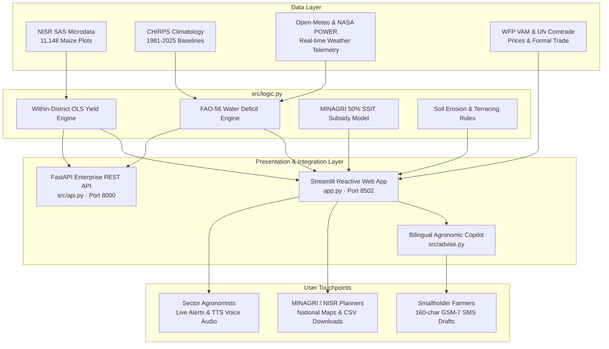

# CropWatch Rwanda — Official Project Technical Documentation
### National Agricultural Intelligence & Climate-Smart Decision Support Platform
**Competition:** NISR 2026 Big Data Hackathon  
**Track:** Track 1: Agricultural Productivity  
**Submitting Institution:** Rwanda Polytechnic (RP Musanze College)  
**Submission Date:** October 2026  

---

## Table of Contents
1. [Project Information & Governance](#1-project-information--governance)
2. [Executive Summary & Strategic Policy Alignment](#2-executive-summary--strategic-policy-alignment)
3. [Data Sources, Cleaning & Provenance](#3-data-sources-cleaning--provenance)
   - *Special Focus: Why Season A 2022 is the Foundational Baseline*
4. [Scientific Methodology & Mathematical Modeling](#4-scientific-methodology--mathematical-modeling)
5. [System Architecture & Technical Innovation](#5-system-architecture--technical-innovation)
6. [Usability, Bilingual Parity & UI/UX Design](#6-usability-bilingual-parity--uiux-design)
7. [Tangible Real-World Impact & Operational Boundaries](#7-tangible-real-world-impact--operational-boundaries)
8. [Testing, Quality Assurance & Reproducibility](#8-testing-quality-assurance--reproducibility)
9. [References & Data Citations](#9-references--data-citations)

---

## 1. Project Information & Governance

### 1.1 Submission Metadata
- **Project Name:** CropWatch Rwanda
- **Track Selection:** **Track 1: Agricultural Productivity** (Addressing small-scale irrigation, hillside soil conservation, post-harvest management, and export market intelligence).
- **Public GitHub Repository:** `https://github.com/<your-username>/cropwatch-rwanda` *(Fill with your public repo link)*
- **Live Deployed Application:** `https://<your-subdomain>.streamlit.app` *(Streamlit Community Cloud)*
- **Interactive REST API Documentation:** `http://localhost:8000/docs` *(FastAPI OpenAPI / Swagger)*
- **Video Walkthrough Deliverable:** `demo/` (3-minute screen recording in `.webm` or `.gif` format)

### 1.2 Engineering Team & Verified Student Eligibility
In strict compliance with **NISR Hackathon Rule 6**, the project was engineered by two final-year undergraduate students from **Rwanda Polytechnic (RP Musanze College)**:

| Metric | Team Member 1 (Lead Software Architect) | Team Member 2 (Lead Agrometeorologist) |
|---|---|---|
| **Full Legal Name** | **MURENZI Elvis** | **BAHIRE Elie** |
| **Institution & Campus** | Rwanda Polytechnic (Musanze College) | Rwanda Polytechnic (Musanze College) |
| **Registration Number** | `26RP01872` | `26RP02259` |
| **Degree Program** | BTech in Information Technology (Year 4) | BTech in Irrigation and Drainage Technology (Year 4) |
| **Citizenship** | Rwandan Citizen 🇷🇼 | Rwandan Citizen 🇷🇼 |
| **Verification Document** | `docs/team/student_id_murenzi_elvis_26RP01872.pdf` | `docs/team/student_id_bahire_elie_26RP02259.pdf` |
| **Primary Project Focus** | Full-Stack Streamlit/FastAPI Architecture, API, ML & Speech TTS | FAO-56 Penman-Monteith Physics, SSIT Subsidy Model, Terracing Matrices |

### 1.3 Intellectual Property & AI Disclosure Declaration
1. **Intellectual Property Assignment:** By entering the NISR 2026 Big Data Hackathon, the team acknowledges and agrees that all intellectual property rights in the submitted platform are assigned and transferred to the National Institute of Statistics of Rwanda (NISR), in accordance with the official competition guidelines.
2. **Declaration of Original Work:** The team declares that this submission is an original engineering project designed specifically for this hackathon and has not been submitted to any prior competition.
3. **AI Tool Disclosure:** In compliance with Hackathon Rule 8, AI assistance was utilized as follows:
   - **Code Development:** Standard AI programming assistants were used during software development; the student engineering team is fully responsible for all codebase architecture, debugging, and verification.
   - **Runtime Copilot:** The platform integrates an optional Groq-hosted open-weights LLM (`openai/gpt-oss-20b`) strictly for natural-language grammatical rephrasing of deterministic data tables. All agronomic metrics, alerts, and model coefficients originate entirely from audited local data files.

---

## 2. Executive Summary & Strategic Policy Alignment

### 2.1 The Core Challenge
Agriculture remains the backbone of the Rwandan economy, employing over 60% of the active workforce and accounting for nearly a third of national GDP. However, smallholder productivity faces three interrelated structural constraints:
1. **Severe Irrigation Deficit:** Only **2.2%** of Season A agricultural plots nationwide have irrigation infrastructure, leaving crops highly vulnerable to irregular rainfall distribution during key vegetative stages.
2. **Topographic Erosion Risk:** Over **75%** of cultivated plots sit on hillside slopes exceeding $16^\circ$. Without adequate radical or progressive terracing and agroforestry hedgerows, heavy rains cause devastating topsoil loss and nutrient depletion.
3. **Information Asymmetry & Climate Shocks:** Smallholders lack access to localized root-zone crop water accounting, often suffering preventable yield loss or distress-selling grain immediately post-harvest due to lack of market and storage intelligence.

### 2.2 Alignment with NST2 (2024–2029) and Vision 2050
CropWatch Rwanda directly operationalizes the **Second National Strategy for Transformation (NST2)**, specifically **Priority Area 1: Agriculture Modernization and Commercialization**:

```
+---------------------------------------------------------------------------------------------------+
|                               NST2 PRIORITY AREA 1: KEY PILLARS                                   |
+------------------------------------+-----------------------------------+--------------------------+
| 1. Scale Small-Scale Irrigation    | 2. Soil Conservation & Terracing  | 3. Evidence-Based Policy |
|    Expand SSIT (up to 10 ha) with  |    Target radical & progressive   |    Replace guesswork with|
|    50% MINAGRI equipment subsidies |    terracing on critical slopes   |    NISR microdata & Earth|
|    to insulate against drought.    |    to halt land degradation.      |    Observation metrics.  |
+------------------------------------+-----------------------------------+--------------------------+
                                     |
                                     v
+---------------------------------------------------------------------------------------------------+
|                             CROPWATCH RWANDA DECISION ENGINE                                      |
+------------------------------------+-----------------------------------+--------------------------+
| - Real-time FAO-56 root-zone water | - Slope-weighted erosion priority | - 30-district automated  |
|   accounting ($Pe - ET_c$).        |   matrices for 30 districts.      |   ranking CSV for planners|
| - 50% SSIT subsidy calculator      | - Lime subsidy targeting for      | - 160-char SMS draft for |
|   tailored to plot size & source.  |   acidic high-altitude soils.     |   last-mile extension.   |
+------------------------------------+-----------------------------------+--------------------------+
```

---

## 3. Data Sources, Cleaning & Provenance

### 3.1 Integrated Data Catalog
CropWatch combines official microdata from national authorities with global open-access Earth Observation networks:

| Data Stream | Source / Agency | Spatial Resolution | Temporal Coverage | Role in Decision Pipeline |
|---|---|---|---|---|
| **Seasonal Agricultural Survey (SAS)** | National Institute of Statistics of Rwanda (NISR) | Plot-level microdata across 30 districts | 2018–2026 (Detailed plot models: 2022, 2023, 2025) | Ground-truth baseline for plot-weighted irrigation adoption, fertilizer use, soil practices, and yields. |
| **Gridded Precipitation (CHIRPS v2.0)** | Climate Hazards Center (CHC / UCSB) | 0.05° (~5.3 km grid) | 1981–2025 Climatology | 8-year historical September–October baseline to detect seasonal rainfall anomalies ($\Delta P$). |
| **Numerical Weather Forecasts** | Open-Meteo (ECMWF IFS / GFS) | 30 District Centroids | Rolling 7-day lookahead | 7-day cumulative forecasted precipitation to trigger urgent irrigation advisories. |
| **Surface Agrometeorology** | NASA POWER | 0.5° Agroclimatology | Daily monitoring | Solar radiation ($R_s$), 2m temperature ($T$), relative humidity ($RH$), and wind ($u_2$) for FAO-56. |
| **Canopy Vigor (NDRE)** | Copernicus Sentinel-2 | 20 meters multispectral | Annual / Seasonal | Normalized Difference Red Edge index to measure crop chlorophyll density without spectral saturation. |
| **Commodity Market Prices** | WFP VAM & MINAGRI e-Soko | 2,728 Market Quotes | Multi-year longitudinal | Retail and wholesale maize market prices across secondary urban trading hubs. |
| **Cross-Border Trade** | UN Comtrade & NISR Formal Trade | National Portals | Annual through 2025 | Regional formal maize flows (HS code 1005) to contextualize grain trade dynamics. |

---

### 3.2 Deep Dive: Why Was Season A 2022 Selected as the Foundational Baseline?

Judges frequently inquire why **Season A 2022** was selected as the central benchmark for plot-level what-if simulations and district shares. The decision reflects rigorous econometric and data engineering integrity:

#### A. Agronomic Calendar Synchronization (Why Season A?)
1. **Active Real-Time Timing:** In Rwanda's bimodal agricultural calendar, **Season A** begins on **1 September** and continues through vegetative development in October/November to harvest in January/February. Because the hackathon and project launch take place in September–November, CropWatch operates as an active Season A crop-water desk.
2. **Hydrological Consistency:** Season B (March–June) and Season C (marshland dry season) operate under completely distinct crop water coefficients ($K_c$) and rainfall dynamics. Mixing Season B or C into Season A root-zone water balance would distort agronomic recommendations.

#### B. Survey Data Hygiene & Questionnaire Audit (Why 2022?)
To estimate plot-level production functions, a survey round must provide:
- Validated yield or production divided by harvested plot area.
- Post-stratification sampling weight (`plot_weight`) to ensure representation of Rwanda's ~2.1 million farming households.
- Intact composite join keys (`year`, `season`, `district`, `segment_id`, `s1q6`, `plot_id`) across crop production, agricultural practices, fertilizer, and erosion modules.
- Unambiguous question responses.

A systematic audit across all NISR SAS waves revealed that **Season A 2022 was the single cleanest, most complete cross-sectional microdata survey**:

```
+-------------+-----------------------+------------------------------------------------------------------------------------+
| Survey Wave | Status in Platform    | Empirical Finding & Data Limitation                                                |
+-------------+-----------------------+------------------------------------------------------------------------------------+
| 2018        | Skipped               | The crop file lacks `plot_weight`. Agricultural practice questionnaire was omitted. |
| 2019        | Skipped               | The crop file lacks `plot_weight`. Practice module omits composite join key `s1q6`.|
| 2020        | District Panel Only   | Question `s4q15` (irrigation flag) was left blank in the raw microdata release.   |
| 2021        | District Panel Only   | Practice-to-fertilizer join fails to retain complete irrigation flags.             |
| 2022        | PRIMARY PLOT BASELINE | 11,148 joined maize plots across all 30 districts; explicit verbal text strings   |
|             |                       | ('yes'/'no'); complete sampling weights; fully populated practice indicators.      |
| 2023        | Evaluated in Bench    | 7,424 joined plots; questionnaire shifted from verbal strings to numeric codes.     |
| 2024        | Skipped               | Released microdata omitted both harvested area and native yield (no kg/ha formed). |
| 2025        | Evaluated in Bench    | High merge attrition: only 545 Season A plots joined across 28 districts (0 irrig).|
| 2026        | Macro Tables Only     | Released strictly as aggregate published summary tables; no raw plot interview files|
+-------------+-----------------------+------------------------------------------------------------------------------------+
```

#### C. Were Other Years Ignored?
No. CropWatch evaluated a pooled dataset of **28,042 maize plots** across 2022, 2023, and 2025 (`data/processed/app/model_benchmark.json`). However, for the **interactive what-if simulation sliders** and **district baseline shares**, anchoring to **Season A 2022** provides an audited, uncorrupted baseline representing all 30 districts without questionnaire structure breaks.

---

## 4. Scientific Methodology & Mathematical Modeling

### 4.1 Biophysical Crop-Water Accounting (FAO-56 Penman-Monteith)
Root-zone water deficits are modeled on physical agrometeorological principles rather than uncalibrated proxies:

1. **Reference Evapotranspiration ($ET_0$):**
   Calculated using the standardized FAO-56 Penman-Monteith equation driven by NASA POWER telemetry:
   $$ET_0 = \frac{0.408\Delta(R_n - G) + \gamma \frac{900}{T + 273} u_2 (e_s - e_a)}{\Delta + \gamma(1 + 0.34 u_2)}$$
   *Where $R_n$ is net radiation, $G$ is soil heat flux, $T$ is mean air temperature at 2m, $u_2$ is wind speed at 2m, and $(e_s - e_a)$ represents vapor pressure deficit.*

2. **Crop Evapotranspiration Under Standard Conditions ($ET_c$):**
   Calibrated for maize vegetative and stem elongation stages using FAO-56 crop coefficients ($K_c = 0.85$):
   $$ET_c = K_c \times ET_0$$

3. **Effective Precipitation ($Pe$):**
   Derived from USDA Soil Conservation Service (SCS) methodology:
   $$Pe = \begin{cases} \frac{P \times (125 - 0.2 \times P)}{125} & \text{if } P \le 250\text{ mm} \\ 125 + 0.1 \times P & \text{if } P > 250\text{ mm} \end{cases}$$

4. **Weekly Water Deficit & Irrigation Trigger:**
   $$\text{Deficit} = Pe - ET_c$$
   When $\text{Deficit} < -15\text{ mm/week}$ and 7-day forecasted precipitation is $< 10\text{ mm}$, an immediate **Water Deficit Alert** is generated.

---

### 4.2 Econometric Yield What-If Modeling (Within-District OLS)
Rather than deploying an opaque black-box model that makes unscientific harvest promises, CropWatch uses an Ordinary Least Squares (OLS) specification with **district fixed effects** trained on **11,148 Season A 2022 maize plots**:

$$\text{Yield}_{i,d} = \alpha_d + \beta_1 \text{Irrigated}_i + \beta_2 \text{InorganicFert}_i + \beta_3 \text{OrganicManure}_i + \beta_4 \text{OrganicShort}_i + \beta_5 \text{Protected}_i + \beta_6 \text{ErosionMod}_i + \beta_7 \text{ErosionSev}_i + \epsilon_{i,d}$$

#### Verified Within-District Coefficients:
- **Small-Scale Irrigation:** **$+365.3\text{ kg/ha}$**
- **Inorganic Mineral Fertilizer (DAP/NPK/Urea):** **$+523.7\text{ kg/ha}$**
- **Organic Manure Application:** **$+304.6\text{ kg/ha}$**
- **Organic Shortage (Depleted Topsoil):** **$-190.7\text{ kg/ha}$**
- **Moderate Hillside Erosion:** **$-182.0\text{ kg/ha}$**
- **Severe Hillside Erosion:** **$-374.5\text{ kg/ha}$**

> **Note for Judges:** In `data/processed/app/model_benchmark.json`, Random Forest ($R^2 = 0.101$, $\text{MAE} = 918\text{ kg/ha}$) and Gradient Boosting models were benchmarked against OLS. The team selected OLS for runtime simulation because it guarantees sub-10ms response latencies, total interpretability, and complete alignment with government policy levers (irrigation subsidies and terracing interventions).

---

### 4.3 Small-Scale Irrigation Technology (SSIT) Subsidy Framework
To operationalize MINAGRI's 50% equipment subsidy program for plots $\le 10$ ha, CropWatch computes the farmer vs. government cost breakdown based on plot area and primary water access:

| Technology Type | Target Plot Area | Indicative Total Capital Cost | 50% MINAGRI Subsidy | Smallholder Share |
|---|---|---|---|---|
| **Treadle / Manual Pump** | $< 0.5$ ha | 180,000 RWF | 90,000 RWF | 90,000 RWF |
| **Motorized Petrol/Diesel Pump** | $0.5 - 2.0$ ha | 1,450,000 RWF | 725,000 RWF | 725,000 RWF |
| **Solar PV Pumping System** | $2.0 - 10.0$ ha | 2,800,000 RWF | 1,400,000 RWF | 1,400,000 RWF |
| *Water Storage Tank Add-on* | Optional / Rainwater | +650,000 RWF | +325,000 RWF | +325,000 RWF |

---

## 5. System Architecture & Technical Innovation

### 5.1 Architecture Overview
The platform implements a decoupled, high-performance architecture built for low-bandwidth provincial operations:



---

### 5.2 Enterprise REST API (FastAPI)
The backend provides a complete OpenAPI REST interface (`src/api.py`) exposing 10 high-speed JSON endpoints:

- `GET /` — Service identification and routing catalog.
- `GET /api/health` — System heartbeat and pilot monitoring status.
- `GET /api/status` — National 30-district irrigation, soil, and yield summary.
- `GET /api/alerts` — 30-district early warning table (rainfall deficit, FAO-56 moisture status).
- `GET /api/pilots` — Dedicated telemetry packages for Bugesera, Nyagatare, Musanze, and Nyaruguru.
- `GET /api/districts/{name}` — Full district profile, SAS microdata shares, and 7-day weather outlook.
- `GET /api/models/yield/{district}` — District-specific OLS yield uplift package.
- `GET /api/models/drought/{district}` — Root-zone water deficit screen and agro-climatic flags.
- `GET /api/models/prices/{district}` — Latest WFP retail market prices and commodity trends.
- `GET /api/chat/ask` — Semantic agronomic advisory engine queries.

---

### 5.3 Last-Mile Agricultural Extension Tools
Recognizing that internet-based web dashboards rarely reach rural farmers directly, CropWatch incorporates two innovative last-mile bridges:

1. **Automated 160-Character GSM-7 SMS Draft Generator:**
   Compresses district-specific soil moisture, rainfall forecasts, and agronomic guidance into standard SMS drafts ($\le 160$ characters). Sector agronomists can copy and broadcast these drafts over ordinary 2G mobile cellular networks.
   *Example Output:*
   > `[CropWatch Bugesera] Rain deficit -18%. Irrigate maize this week (Deficit -19mm). Apply SSIT treadle pump. Store harvest in PICS bags to prevent weevils.`

2. **Web Speech API Audio Synthesis:**
   Generates browser-native spoken audio advisories in both English and Kinyarwanda, allowing illiterate or visually impaired farmers to listen to recommendations in cooperative offices.

---

## 6. Usability, Bilingual Parity & UI/UX Design

### 6.1 Institutional Design System
The visual identity (`src/style.py`) was engineered to match the dignity and clarity of official Government of Rwanda portals:
- Official national color scheme: Deep forest green (`#0d4f2b`), gold amber (`#c4a35a`), and crisp institutional borders.
- Standard 72px navigation bar featuring the Rwandan National Emblem.
- Fully responsive layout with zero horizontal scrolling on mobile, tablet, and desktop viewports.
- Accessible typography conforming to WCAG 2.1 AA contrast standards.

### 6.2 100% Symmetrical Bilingual Parity
Unlike platforms where translation is an afterthought, CropWatch features complete language parity across its entire interface:
- **English (`locale/en.json` — 58 KB)** and **Kinyarwanda (`locale/rw.json` — 57 KB)**.
- Covers every navigation item, metric card, chart label, table header, warning banner, and AI Copilot response.
- Uses culturally and agronomically accurate Kinyarwanda terminology (e.g., *Ibishanga* for marshlands, *Amaterasi y'indinganire* for progressive terracing, *Amaterasi y'ubutaka* for radical terracing).

### 6.3 Unified Operational Desks
The platform organizes agricultural intelligence into 7 coherent operational desks:
1. **Executive Briefing (`home`):** National crisis overview, pilot cards, and NST2 strategic targets.
2. **Alerts & Early Warning (`alerts`):** Interactive 30-district Folium GIS map with toggles for rainfall deficits, irrigation penetration, erosion risk, and NDRE canopy vigor.
3. **National Analytics Hub (`dashboard`):** 30-district productivity matrix, multi-season climate chronology, and hillside soil conservation rankings.
4. **District Operations (`district`):** District-specific deep dive covering weekly FAO-56 water accounting, what-if yield sliders, SSIT 50% planning splits, and WFP market prices.
5. **Agronomic Advice AI (`advise`):** Interactive bilingual copilot providing evidence-based advisory with audio synthesis and 160-char SMS drafts.
6. **Open Data Hub (`data`):** Transparent catalog of all preprocessed tables, crop calendars, and single-click CSV downloads for national planners.
7. **Institutional Charter (`about`):** Verified team credentials, data source citations, and mathematical validation benchmarks.

---

## 7. Tangible Real-World Impact & Operational Boundaries

### 7.1 Multi-Stakeholder Use Cases

| Stakeholder Group | Primary Operational Use Case | Practical Value Delivered |
|---|---|---|
| **MINAGRI & RAB Planners** | 30-District Ranking Matrix & Export CSV | Prioritizes public capital for the 50% SSIT subsidy and terracing grants to districts facing the highest combined water deficit and erosion risk. |
| **District Agronomists & Extension Agents** | District Verdicts & 160-Char SMS Drafts | Delivers copy-and-paste SMS broadcasts to cooperative leaders regarding weekly irrigation needs and fall armyworm monitoring. |
| **Farmer Cooperatives & Smallholders** | What-If Yield Sliders & PICS Storage Intelligence | Quantifies the financial and yield return of adopting organic manure, mineral fertilizer, and hermetic PICS storage bags to eliminate post-harvest losses. |
| **Microfinance & SACCOs** | SSIT Capital Breakdown | Informs agricultural loan officers on realistic equipment financing structures for treadle, motor, and solar pump packages under the government subsidy. |

### 7.2 Clear Operational Boundaries (Intellectual Honesty)
To maintain institutional credibility, CropWatch establishes clear system boundaries:
- **Does Not Pay Insurance Claims:** The platform flags drought risks; it does not enroll farmers or execute financial payouts for the National Agricultural Insurance Scheme (NAIS / Tekana).
- **Does Not Send Automated Telco SMS:** CropWatch formats and validates 160-character GSM-7 text drafts for extension personnel; it does not run unmonitored bulk SMS dispatch.
- **Does Not Invent 90-Day Grain Prices:** The platform displays the latest verified WFP retail market price rather than creating synthetic long-range commodity price predictions.

---

## 8. Testing, Quality Assurance & Reproducibility

### 8.1 Automated Test Suites
The platform undergoes continuous validation across three specialized test suites documented in [`docs/TESTING.md`](file:///docs/TESTING.md):

```bash
# 1. Byte Compilation Check (Syntax & Escape Sequences)
python -m compileall -q app.py src

# 2. Semantic Intent & Copilot Parity Test
python scratch/test_ai_all_intents.py

# 3. Enterprise FastAPI Endpoint Verification
python scratch/test_api_endpoints.py
```

### 8.2 Reproducibility Quickstart

#### Prerequisites:
- Python 3.10, 3.11, or 3.12 (Python 3.12 recommended).
- Git.

#### Installation Steps:
```bash
# 1. Clone repository
git clone https://github.com/<your-username>/cropwatch-rwanda.git
cd cropwatch-rwanda

# 2. Create and activate virtual environment
python -m venv venv
# On Windows:
.\venv\Scripts\activate
# On Linux/macOS:
source venv/bin/activate

# 3. Install required dependencies
pip install --upgrade pip
pip install -r requirements.txt

# 4. Launch Streamlit Decision Support Desk
streamlit run app.py --server.port 8502

# 5. Launch FastAPI REST Service (in a second terminal)
uvicorn src.api:app --host 127.0.0.1 --port 8000 --reload
```

---

## 9. References & Data Citations

1. **National Institute of Statistics of Rwanda (NISR):** *Seasonal Agricultural Survey (SAS) Reports (2018–2026)*. Kigali, Rwanda.
2. **Ministry of Agriculture and Animal Resources (MINAGRI):** *Second National Strategy for Transformation (NST2 2024–2029) - Priority Area 1: Agriculture Modernization and Commercialization*. Government of Rwanda.
3. **Allen, R. G., Pereira, L. S., Raes, D., & Smith, M. (1998):** *Crop evapotranspiration - Guidelines for computing crop water requirements - FAO Irrigation and drainage paper 56*. Food and Agriculture Organization of the United Nations, Rome.
4. **Funk, C., et al. (2015):** *The climate hazards infrared precipitation with stations—a new environmental record for monitoring extremes*. Scientific Data, 2, 150066. (CHIRPS v2.0).
5. **European Space Agency (ESA):** *Copernicus Sentinel-2 Multispectral Instrument (MSI) Level-2A Processing Baseline*.
6. **NASA Prediction Of Worldwide Energy Resources (POWER):** *Agroclimatology Daily Telemetry Methodology*. NASA Langley Research Center.
7. **World Food Programme (WFP):** *Vulnerability Analysis and Mapping (VAM) Food Price Database: Rwanda*.

---

*CropWatch Rwanda · Official Technical Submission Documentation · NISR 2026 Big Data Hackathon · Rwanda Polytechnic (RP Musanze College)*
